  

<h1 align="center">Software Developer &amp; Data Analyst</h1>

  I build practical software and use data to turn questions into clear, useful answers.

  <a href="https://linkedin.com/in/vishal-tanwar70">LinkedIn</a> ·
  <a href="mailto:tanwarvishal8971@gmail.com">Email</a> ·
  <a href="https://github.com/vishxltanwar">GitHub</a>

---

## About

I work across software development and data analytics: writing Python and SQL, building small applications, exploring datasets, and presenting findings through dashboards. I enjoy projects where code makes information easier to use and decisions easier to make.

## Featured projects

| Project | Focus | What it demonstrates |
| --- | --- | --- |
| [Student Record Manager](https://github.com/vishxltanwar/student_manager_python) | Python application | A command-line app to add, view, search, update, and delete student records. |
| [HR Analytics](https://github.com/vishxltanwar/HR-Analytics-PowerBI) | Power BI · DAX · Power Query | An interactive dashboard exploring workforce distribution, salary trends, and tenure. |
| [Netflix Data Analysis](https://github.com/vishxltanwar/netflix-data-analysis) | Python · Pandas · Jupyter | Exploratory analysis of content types, genres, countries, ratings, and platform growth. |
| [Customer Sales Analysis](https://github.com/vishxltanwar/sql-customer-sales-analysis) | SQL | Queries that explore customer and sales data through practical business questions. |

## Skills

**Software development** 
Python · Django · Flutter · Dart · Git · Firebase · AWS

**Data analytics** 
SQL · PostgreSQL · MySQL · SQL Server · Pandas · NumPy · Power BI · DAX · Excel

## GitHub activity

  
  

  

---

<i>Building useful software and finding clarity in data.</i>

